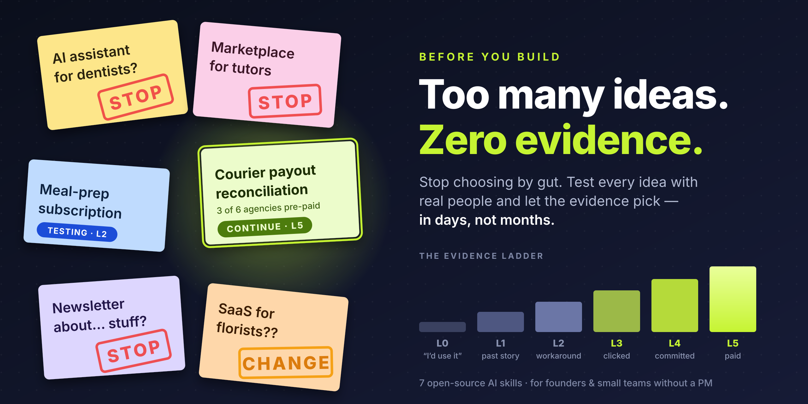

<p align="center"></p>

# Before You Build

**Find out if your idea deserves to be built — with real evidence, not AI enthusiasm.**

An open-source kit of seven AI skills and a simple method for testing product and startup ideas. Built for **founders and small teams without a product manager**. Works in Claude Code, Claude.ai, Codex, Cursor and other agents that support skills.

```
 idea ──► assumptions ──► riskiest one ──► cheapest test ──► real people
   ▲                                       (bar set BEFORE)          │
   └──────── CONTINUE · CHANGE · STOP ◄──────── log what happened ◄──┘
```

---

## Why this exists

Most new products fail for a boring reason: the team spends months building something before anyone outside the team gets a chance to say *no*.

AI makes this easier to do, not harder. Ask a chat assistant about your idea and it will find reasons it's great, write you a market analysis and a feature list, and the polished document will *feel* like validation. It isn't. Nobody paid, nobody clicked, nobody changed what they do.

There are already excellent libraries of product-management frameworks as AI skills. This kit is deliberately different: **it doesn't generate more documents. It runs a discipline.** It helps you pick the bet most likely to kill your idea, design the cheapest test that could prove it wrong, fix the pass/fail bar before you look, record what real people actually did, and reach a verdict.

## Can't choose between ideas?

Most people with ten ideas don't need an eleventh framework to rank them by gut. They need a week. Give `byb-start` your list: it shortlists the 2–3 ideas you can test fastest with people you can actually reach, sets a kill test for each, and lets the verdicts pick. Ideas that die in a week were never going to survive six months of building.

## What makes it different

- **It argues with you.** The skills never call an idea "good" or "validated". They name the assumption most likely to kill it and the strongest case against each verdict.
- **Behaviour over opinion.** Every observation gets a level on the [evidence ladder](method/evidence-ladder.md) — from L0 *"I'd use that"* to L5 *money paid*. Fifty compliments are still L0.
- **The bar is set before the test.** Success and kill lines are written down in advance and can't be moved afterwards. The skills refuse to move them.
- **Every test ends in a decision.** CONTINUE, CHANGE (one thing) or STOP — never "let's keep exploring".
- **Remove before you test.** Before testing an assumption, the kit asks whether a change of plan can make it unnecessary — and whether you need to build anything at all.
- **Plain files your team can see.** Everything lives in a `validation/` folder as Markdown. No database, no account, no lock-in.

## The skills

| Skill | Use it when | You get |
|---|---|---|
| [`byb-start`](skills/byb-start/SKILL.md) | You have an idea — or several and can't choose — or want to know where things stand | A folder for the idea, five questions, the riskiest assumption, one next step. With several ideas: a shortlist by testability and a one-week plan of parallel kill tests |
| [`byb-assumptions`](skills/byb-assumptions/SKILL.md) | "What should I test first?" | The full chain of assumptions, ranked; ones you can remove; a build/no-build check |
| [`byb-test-plan`](skills/byb-test-plan/SKILL.md) | "How do I test this?" | The cheapest test from a [catalog of 14](skills/byb-test-plan/references/test-catalog.md), a pre-registered bar, and ready-to-use assets (messages, landing copy, offer) |
| [`byb-interview`](skills/byb-interview/SKILL.md) | Before or after talking to customers | A script that avoids leading questions; analysis of notes into counted patterns and evidence |
| [`byb-log`](skills/byb-log/SKILL.md) | You have results | Raw numbers logged with sources and evidence levels — no spin |
| [`byb-decide`](skills/byb-decide/SKILL.md) | "What do these results mean?" | A verdict against the original bar, a counter-argument, one next step; weekly reviews |
| [`byb-sprint`](skills/byb-sprint/SKILL.md) | You want a plan | A dated 14-day sprint from idea to verdict, sized to your real hours |

## Quick start

**Claude Code**

```
/plugin marketplace add ivnlap/before-you-build
/plugin install before-you-build@before-you-build
```

Then: `/byb-start` — or simply describe your idea.

**Claude.ai, Codex, Cursor, or any chat assistant** — see [docs/install.md](docs/install.md). There's a no-terminal path for Claude.ai and a copy-paste path for anything else.

## What a session looks like

> **You:** I want to build an app that helps private tutors schedule lessons and chase unpaid ones. $8/month.
>
> **byb-start:** Here's the riskiest assumption: *tutors with 10+ students lose real money or hours to this every month.* Right now your evidence is your own experience — that's one person, L1. I can already see at least 3 fatal bets with no evidence (problem, switching, price). Next step: map them with `byb-assumptions`, then test the problem with 10 tutors you don't know.
>
> *…five days and ten interviews later…*
>
> **byb-decide:** **STOP.** 2 of 10 described a recent loss; your kill line was 3. 7 of 10 say a calendar plus a messenger works fine. Not concluding: that tutors have no problem worth solving — 4 of 10 raised finding new students, unprompted. That's a new idea, not a pivot of this one. Time spent: ~9 hours instead of two months of building.

Both full worked examples, with every file the skills produce, are in [examples/](examples/): one ends in **CHANGE**, one in **STOP**.

## The method in one page

Read [method/README.md](method/README.md): the loop, nine rules, the evidence ladder, the four verdicts, and the file layout. It works with or without AI.

## How this was checked

[evals/](evals/) holds thirteen behaviour checks — for example, "40 friends said they'd use it, is it validated?" must be answered with *no* and a real test. Run them yourself after changing a skill.

## Standing on shoulders

The kit is an original synthesis, written from scratch. Its ideas come from Steve Blank, Eric Ries, Rob Fitzpatrick, Teresa Torres, David Bland & Alex Osterwalder, Alberto Savoia, Ash Maurya, Clayton Christensen, Bob Moesta, Tony Ulwick, Marty Cagan, Rik Higham, Ivan Zamesin and Sean Ellis. See [method/sources.md](method/sources.md) for who contributed what — and read the originals.

## Contributing

Issues and pull requests are welcome: new tests for the catalog, worked examples from real (anonymised) projects, translations, and automation for the behaviour checks. See [CONTRIBUTING.md](CONTRIBUTING.md).

If you ran the kit on a real idea, I'd love to hear how it went — open an issue with the `story` label.

## About

Created by **Ivan Lapa**, product manager working on courier, operations and payments products in food delivery (Uzum Tezkor; previously Yandex Pro). I built this because I kept watching smart people — myself included — spend months building before anyone could say no.

This is a personal project. It isn't affiliated with or endorsed by my employer and contains no employer data.

## Licence

[MIT](LICENSE) — free to use, adapt and share, including inside companies. If you use the kit in a course, an article or research, please cite it ([CITATION.cff](CITATION.cff)).
